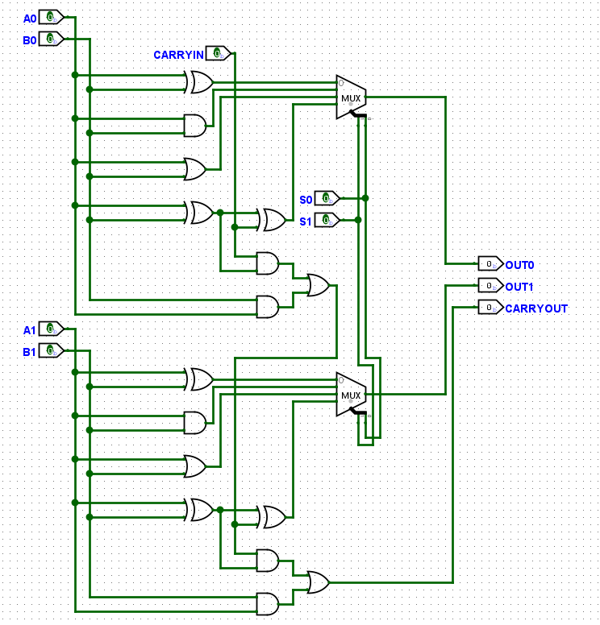
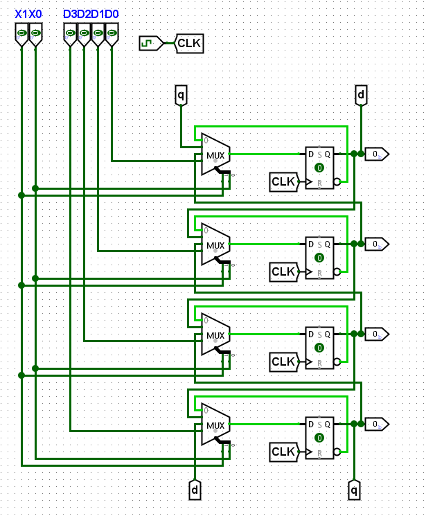
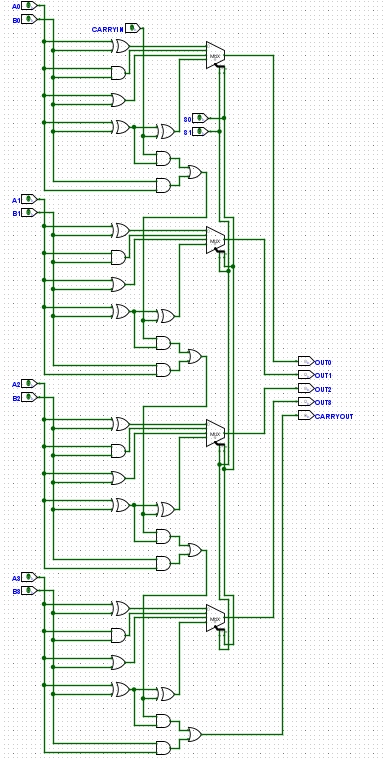
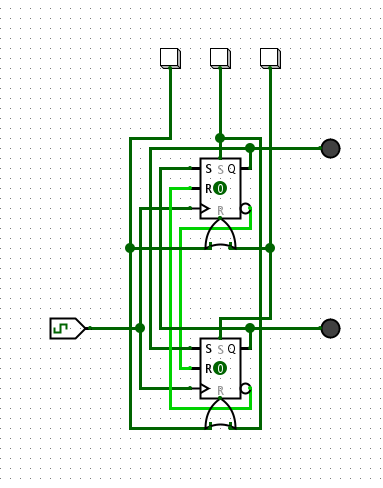

# Logisim ALU and Shifter

A small ALU and a 4-bit shift register built in Logisim Evolution, made to
learn and test how these blocks work at gate level.

## Versions

- **2bit_alu:** 2-bit ALU with XOR, AND, OR and full-adder addition
- **4bit_shifter:** 4-bit register with invert, rotate left, rotate right and parallel load
- **4bit_alu_shifter_wip:** the ALU widened to 4 bits next to the shifter, as a first step toward combining them (work in progress, see below)
- **extras/sr-clock-toggle:** a small S-R flip-flop control circuit (see Extras)

## 2-bit ALU

Each bit computes XOR, AND, OR and a full-adder sum in parallel, and a 4-input
MUX picks one of them with `S1 S0`. The adder carry runs from bit 0 into bit 1
and out of `CARRYOUT`.

| S1 | S0 | Operation |
|----|----|-----------|
| 0 | 0 | A XOR B |
| 0 | 1 | A AND B |
| 1 | 0 | A OR B |
| 1 | 1 | A + B + CARRYIN |

`CARRYOUT` is always computed but only means something in the add mode.

## 4-bit Shifter

Four D flip-flops, each fed by a 4-input MUX. `X1 X0` selects what every
flip-flop loads on the next clock edge.

| X1 | X0 | Mode | Next state |
|----|----|------|------------|
| 0 | 0 | Invert | every bit takes its own Q̅ |
| 0 | 1 | Rotate left | bit *i* ← bit *i−1*, bit 3 wraps into bit 0 |
| 1 | 0 | Rotate right | bit *i* ← bit *i+1*, bit 0 wraps into bit 3 |
| 1 | 1 | Parallel load | bits ← D3..D0 |

The ends are looped back through the `q` and `d` tunnels, so the shift is a
rotation: the pattern keeps circulating on every clock instead of falling off
the end. There is no separate hold mode; the invert mode was added on purpose
to watch the register toggle.

## 4-bit ALU + Shifter (work in progress)

`4bit_alu_shifter_wip.circ` holds the same four ALU operations widened to
4 bits (`A3..A0`, `B3..B0`, `OUT3..OUT0`, carry chained through all bits), and
a copy of the shifter on the same sheet. The two are **not connected yet**:
the shifter still takes its data from its own `D3..D0` input pins.

The goal was an ALU that can also multiply and divide. The steps toward that:

1. Wire `OUT3..OUT0` into the shifter's `D3..D0`, so the load mode latches the ALU result and the shifter can shift it (a left shift multiplies by 2).
2. Add subtraction to the ALU: XOR `B` with a `SUB` line and feed `SUB` into `CARRYIN` (two's complement).
3. Add an accumulator register and a small FSM to sequence shift-and-add multiplication and shift-and-subtract division.

## Extras — S-R Clock Toggle

Two clocked S-R flip-flops with three buttons, made to test how S-R latches
behave:

- **Left button:** stops the circuit and resets both flip-flops. Both LEDs go off.
- **Either of the other two buttons:** starts the circuit. It oscillates, and the
  lit LED keeps switching from one flip-flop to the other on the clock.
- **Holding one of those two buttons** sets one flip-flop and resets the other
  for as long as it is pressed, so the lit LED stays on that side.

Buttons are used instead of switches on purpose. With switches, both inputs
could be left on and drive S and R high at the same time, the forbidden S-R
input. Logisim only lets you press one button at a time, so the button inputs
make S = R = 1 impossible in practice.

## Tools
Logisim Evolution v4.1.0
